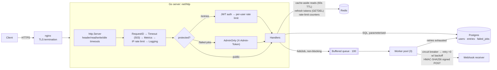

# Personal Analytics Backend

A Go HTTP API for a personal journaling/analytics app: users register, log mood entries, and
read them back paginated and filtered. Every write also fires a signed webhook in the background.

The point of the project is the backend engineering around that small domain: stateless auth
with rotating refresh tokens, Postgres with versioned migrations, Redis for caching and rate
limiting, a bounded worker pool with retries, a circuit breaker and a dead-letter queue, and the
tests that prove those pieces behave under concurrency and failure.

> **Status (Oct 2026):** single-instance service, built and run locally with Docker Compose.
> The suite runs with Go's race detector against real Postgres 16 and Redis 7.
> It is a portfolio project, not a system with production traffic.
> [docs/ENGINEERING-NOTES.md](docs/ENGINEERING-NOTES.md) records the defects found and fixed,
> with before/after evidence, and lists what is still weak.

## Architecture



**Write path (`POST /entries`):** auth → validate → insert in Postgres → invalidate cached pages →
enqueue a webhook job (non-blocking; if the queue is full the job is dropped and logged) → `201`.
A worker sends the job through a circuit breaker and retry loop. A job that still fails is stored in
`failed_jobs`, where an operator can read it via `/failed-jobs`.

**Auth:** login returns a 15-minute HS256 access JWT plus an opaque refresh token stored in Redis
for 7 days. `/refresh` consumes that token with one atomic `GETDEL` and issues a new pair, so a
replayed or stolen refresh token works at most once.

**Shutdown (SIGINT/SIGTERM):** the server stops accepting connections and drains in-flight requests
(5s budget). The worker pool then stops accepting jobs and finishes every job it already accepted.
Redis and Postgres close last.

## API

| Method | Path | Auth | Notes |
|---|---|---|---|
| GET | `/health` | — | Pings Postgres + Redis; `503` if either is down |
| GET | `/ping` | — | Liveness |
| POST | `/register` | — | `{email, password}`; bcrypt hash; `409` on duplicate email |
| POST | `/login` | — | Returns `access_token` (15 min) + `refresh_token` (7 days) |
| POST | `/refresh` | refresh token | Rotates: old token is consumed, new pair issued |
| POST | `/logout` | refresh token | Revokes the refresh token |
| GET | `/entries` | Bearer JWT | `page`, `limit` (≤100), `category`, `mood_min`; per-user isolation |
| POST | `/entries` | Bearer JWT | `{text, mood 1–10, category}` |
| PATCH / DELETE | `/entries?id=N` | Bearer JWT | `404` if the entry isn't the caller's |
| GET | `/metrics` | — | Per-path request counts, errors, latency (JSON) |
| GET | `/failed-jobs` | `X-Admin-Token` | Dead-letter queue; disabled (`404`) unless `ADMIN_TOKEN` is set |

## Run it

Requirements: Docker. Go 1.25+ only if you want to run tests outside Docker.

```bash
docker compose -f docker-compose.yml -f docker-compose.dev.yml up --build -d app
bash scripts/demo.sh        # 8-step walkthrough with curl
docker compose -f docker-compose.yml -f docker-compose.dev.yml down -v
```

The dev overlay starts only the API, Postgres and Redis (no nginx/certbot) and publishes
`localhost:8080`. It also points `WEBHOOK_URL` at a closed port on purpose, so the demo exercises
the retry → circuit breaker → dead-letter path.

### Configuration

| Variable | Default | Purpose |
|---|---|---|
| `JWT_SECRET` | — (required) | HS256 signing key |
| `DB_HOST` `DB_PORT` `DB_USER` `DB_PASSWORD` `DB_NAME` | `localhost` `5432` `user` `password` `analytics` | Postgres |
| `REDIS_HOST` `REDIS_PORT` | `localhost` `6379` | Redis (≥ 6.2 for `GETDEL`) |
| `ADMIN_TOKEN` | empty → `/failed-jobs` disabled | Operator token |
| `REQUEST_TIMEOUT` | `10` (s) | Per-request deadline → `503` |
| `SHUTDOWN_TIMEOUT` | `5` (s) | Drain budget for in-flight requests |
| `RATE_LIMIT_REQUESTS` / `RATE_LIMIT_WINDOW` | `100` / `60` (s) | Per-IP fixed window |
| `WORKERPOOL_SIZE` | `3` | Webhook workers |
| `WEBHOOK_URL` / `WEBHOOK_SECRET` | empty | Target and HMAC key for `X-Webhook-Signature` |
| `LOG_LEVEL` | `DEBUG` | `slog` JSON logs |

## Tests

```bash
bash scripts/test-integration.sh   # vet + full suite with -race against real Postgres 16 + Redis 7, all in Docker
go test ./cmd/... ./internal/...   # unit tests only; DB/Redis tests skip when DB_HOST / REDIS_ADDR are unset
```

Last full run (2026-10-29, `golang:1.25` container): **78 tests passed, 0 failed, 0 data races**,
stable across `-count=3`. `go vet` is clean, and `golangci-lint v2.5.0` reports 0 issues.

What the tests cover, beyond CRUD and validation:

| Property | Test |
|---|---|
| A handler that outlives its deadline can't write to the client; a handler panic is recoverable | `internal/handlers/timeout_test.go` |
| A refresh token is accepted once under 10 concurrent replays; it's revoked on rotation and on logout | `internal/handlers/refresh_test.go` |
| `GETDEL` gives exactly one winner among 50 concurrent consumers (real Redis) | `internal/redis/redis_test.go` |
| Shutdown processes every accepted job; enqueue during or after shutdown never panics | `internal/worker/worker_test.go` |
| Circuit breaker lets independent calls run concurrently; half-open admits exactly one trial | `internal/circuitbreaker/concurrency_test.go` |
| `/failed-jobs` rejects missing/wrong tokens and is off by default | `internal/handlers/admin_test.go` |
| The DB password never reaches logs; migrations run from any working directory | `internal/db/db_test.go` |
| Server timeouts are set; SIGTERM triggers graceful shutdown | `cmd/server/server_test.go` |

Statement coverage by package (2026-10-29): retry 100%, circuitbreaker 91.2%, config 89.7%, webhook 85.0%,
worker 69.4%, db 57.6%, handlers 57.0%, redis 12.5%, cmd/server 1.6%. Each test package that needs
Postgres gets its own database (`internal/testdb`), so packages can run in parallel safely.

## Engineering decisions (short version)

- **`http.TimeoutHandler` instead of a hand-rolled timeout goroutine.** The original version raced
  on the `ResponseWriter` and let a panic crash the process. The stdlib wrapper buffers output under a
  mutex. The cost is a `503` instead of a `504`, and no streaming responses behind it.
- **`GETDEL` for refresh tokens.** One atomic Redis command instead of `GET` + `DEL`. Simpler than
  a Lua script or `WATCH`/`MULTI` and sufficient for a single-key consume. Requires Redis 6.2+.
- **Circuit breaker locks only around state transitions, not around the call.** The original held its
  mutex through the retry/backoff and HTTP call, so the three webhook workers sent one at a time.
  A generation counter stops a slow, stale result from flipping the state.
- **Worker pool:** the `WaitGroup` counts workers, not jobs, and an `RWMutex` guards close-vs-send.
  Handlers enqueue concurrently under the read lock; shutdown closes the queue under the write lock.
- **Migrations embedded with `go:embed`.** The binary works the same from tests, the CLI, and the container.
- **Lint version pinned** (`v2.5.0`): CI can no longer turn red because an upstream release changed.

Full write-up with root causes, evidence and alternatives: [docs/ENGINEERING-NOTES.md](docs/ENGINEERING-NOTES.md).

## Known limitations

Listed with impact and proposed fixes in [docs/ENGINEERING-NOTES.md](docs/ENGINEERING-NOTES.md#known-limitations):
cache invalidation covers only page 1; behind nginx every client shares one rate-limit bucket;
login response time reveals whether an email exists; no request-body size limit; jobs in the
in-memory queue are lost if the process crashes; no index on `entries(user_id, created_at)`.

## Repository layout

```
cmd/server/          main.go (wiring, routes, shutdown) · server.go (http.Server config)
internal/handlers/   HTTP handlers + middleware (auth, admin, rate limit, timeout, metrics, request id)
internal/db/         Postgres store, embedded migrations
internal/redis/      Redis client + cache adapter
internal/worker/     bounded worker pool, dead-letter handoff
internal/circuitbreaker, internal/retry, internal/webhook (HMAC signing)
scripts/             test-integration.sh, demo.sh
docs/                ENGINEERING-NOTES.md; docs/archive and the root *.md files are older learning notes
learning-demos/, test-endpoints/   standalone learning scripts — not built or tested by CI
```
